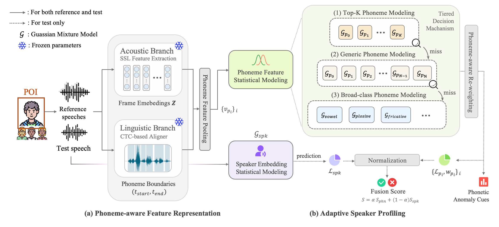

# Profiling the Voice: Speaker-Specific Phoneme Fingerprinting for Speech Deepfake Detection

🤗 [ZH-Famous Dataset](https://huggingface.co/datasets/PVP-ADD/ZH-Famous) is available at huggingface hub.

This repository contains the official code for our paper accepted to IJCAI 2026.




## Abstract

The rapid advancement of generative AI has made audio deepfakes increasingly indistinguishable from authentic human vocals, posing significant threats to persons-of-interest (POI) such as public figures. Current detection systems primarily rely on generic, black-box models that fail to capture speaker-specific idiosyncratic traits and lack interpretability. In this paper, we propose Phoneme-based Voice Profiling (PVP), a novel personalized defense framework. By shifting the detection paradigm from macro-utterance analysis to micro-phonetic modeling, PVP captures the unique acoustic distributions underlying a POI’s habitual articulatory patterns. Specifically, our framework models speaker-specific phonetic realizations using lightweight Gaussian Mixture Models (GMMs) estimated solely from bona fide reference speech. This design enables data-efficient profiling and robust generalization to previously unseen spoofing attacks without requiring heavy spoof-specific training. Furthermore, we introduce the first large-scale Chinese POI deepfake dataset to benchmark speaker-specific detection. Experimental results demonstrate that PVP significantly outperforms state-of-the-art generic detectors in POI spoofing scenarios, achieving substantial EER reductions while providing fine-grained, phoneme-level interpretability for forensic analysis.

## 🚀 Installation

We provide a shell script to automate the environment setup (conda + python3.9).

```bash
git clone https://github.com/JunXue-tech/PVP
cd PVP
sh install.sh
```


## 📂 Directory Structure

| File / Folder	| Description |
| -------- | -------- |
| `backbones/` | Wrapper scripts for various pre-trained Self-Supervised Learning (SSL) models. |
| `protocols/` | Contains dataset metadata (`.csv` files) with Reference and Test keys. |
| `analyzer.py` | The `UniversalPhonemeAnalyzer` class. Handles phoneme recognition and SSL feature extraction. |
| `data.py` | Data loading utilities and protocol parsing logic. |
| `utils.py` | Utility functions for evaluation metrics, scoring, and visualization. |
| **`1_backbone_baseline.py`** | Evaluates standard SSL backbones without phoneme-level profiling. |
| **`2_PVP.py`** | **The Main Method.** Implements Adaptive Phoneme Profiling and weighted scoring. |
| **`3_motivation_exp.py`** | Analyzes phoneme stability and speaker-specific variance. |
| **`4_ablation_GMM.py`** | Ablation study using GMMs instead of Centroid-based profiling. |
| **`4_ablation_phoneme.py`** | Compares phoneme-level vs. utterance-level granularity. |
| **`4_ablation_top_k.py`** | Tests the impact of selecting the Top−K Phonemes. |

## 🧠 Backbone Models

The feature extraction layer of this project relies on state-of-the-art SSL models. We specifically utilize the pre-trained weights provided by the NII-Yamagishilab (National Institute of Informatics).

Source: [NII-Yamagishilab Anti-Deepfake Collection Hugging Face](https://huggingface.co/collections/nii-yamagishilab/antideepfake)

🥰 Thanks to the NII-Yamagishilab team for their contributions to the anti-deepfake research community!

## 🛠️ Usage

### 1. Data Preparation

Our hybrid system requires two protocol files (Enrollment and Testing) in .csv format to build speaker-specific profiles and perform verification.

Protocol Format: We have provided protocol files in the `protocols/` directory as examples. You can create your own protocols following the same structure. Both enrollment and test files must follow this header structure:
`speaker,path,source,label`

Download [`ZH-Famous`](https://huggingface.co/datasets/PVP-ADD/ZH-Famous) and [`Famous Figures`](https://huggingface.co/datasets/issf/famousfigures) datasets from Hugging Face and organize the audio files according to the paths specified in the protocol files. The directory structure should look like this:

```plaintext
./zh_famous/
└── wav/
    ├── speaker1_ref1.wav
    ├── speaker1_test1.wav
    └── ...
```

### 2. Configuration

The system behavior is controlled by several key parameters in the script. You can modify these parameters in to suit your experimental setup:

- **BACKBONE**: Choose the SSL feature extractor (`MMS`, `wav2vec_small`, `wav2vec_large`, `xlsr_1b`, or `hubert_xlarge`).

- Hybrid Alpha (α): Located in the predict method. 
  - α=0.8: Highly prioritizes Phoneme Details (Better for detecting deepfakes).
  - α=1.0: Purely Phoneme-based (No ASV contribution).

- Device: Set `cuda_index` to your target GPU.

### 3. Running the Hybrid Detector

The `HybridPOIDetector` combines ASV (Automatic Speaker Verification) using ECAPA-TDNN embeddings with our **Phoneme-level Profiling**.

To run the full POI specificity experiment:


```Bash
python 2_PVP.py 
```
 
### 4. Results and Evaluation

After running the experiment, the system generates a POI Specificity Report including:

- **EER (Equal Error Rate)**: Calculated for the fused scores across all trials.

- **AUC (Area Under Curve)**: Measures the overall separability of Bonafide vs. Spoof.

- JSON Logs: Per-speaker performance metrics are saved to the results/ directory for detailed analysis.

## 🤝 Citation
If you find this work useful in your research, please consider citing:
```bibtex
@article{xue2026profiling,
  title={Profiling the Voice: Speaker-Specific Phoneme Fingerprinting for Speech Deepfake Detection},
  author={Xue, Jun and Zhang, Tong and Yi, Zhuolin and Huang, Yihuan and Chai, Yi and Zhang, Yiyang and Ren, Yanzhen},
  journal={arXiv preprint arXiv:2605.17737},
  year={2026}
}
```
